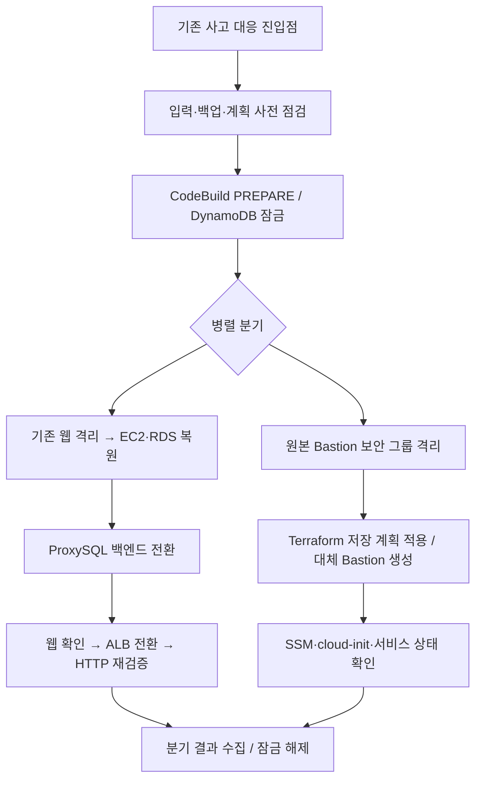

# AWS 장애 대응·서비스 복구 및 Bastion 재구축 자동화

**1차 팀 프로젝트 · 김준백 담당 코드**

기존 보안 격리 워크플로우에 서비스 복구와 운영 Bastion 재구축을 연결한 프로젝트입니다. 웹 EC2·RDS 복구, ProxySQL 연결 변경, ALB 전환과 검증을 수행하고, 별도 분기에서 Terraform으로 대체 Bastion을 생성하도록 통합했습니다.

> 면접관께: [검증 기록](docs/VERIFICATION.md) → [핵심 코드 안내](#핵심-코드) 순서로 보시면 담당 범위와 구현 근거를 빠르게 확인할 수 있습니다. 이 저장소는 실제 개발 산출물을 정리한 공개 스냅샷이며, 환경별 값은 예시로 치환했습니다.

## 담당 범위와 협업 경계

| 구분 | 내용 |
|---|---|
| 직접 담당한 작업 | 복구 흐름 연결·보완, ProxySQL 백엔드 변경 검증, 웹 응답·ALB 전환 검사, Terraform Bastion 재구축, 병렬 분기 통합, 사전 점검과 오류 대응 |
| 팀 공통 환경·연동 대상 | 기존 웹 서비스, AWS 네트워크, 기존 보안 격리 State Machine/Lambda, 원본 EC2·RDS·ProxySQL |
| 개인 성과로 주장하지 않는 항목 | 전체 보안 탐지 시스템 개발, 모든 네트워크 구축, 팀 전체 서비스 코드 작성 |

AI 도구를 활용하며 코드를 구성·수정하고 실제 환경에서 실행 결과를 확인했습니다. 저장소의 파일 생성과 검증 수준은 [공개본 안내](docs/PUBLICATION.md)에 구분했습니다.

## 구조



병렬 분기 중 하나만 성공했다고 전체 복구를 성공으로 처리하지 않습니다. Terraform은 대체 Bastion을 관리하며 원본 인스턴스를 자동 삭제하지 않습니다. 서비스 경로는 `사용자 → ALB → 웹 → ProxySQL → RDS`를 유지합니다.

## 핵심 코드

| 경로 | 읽어볼 부분 |
|---|---|
| [src/team5-bastion-integration/design.py](src/team5-bastion-integration/design.py) | 기존 정의를 감싸는 병렬 워크플로우와 CloudFormation 템플릿 생성 |
| [runtime/worker.py](src/team5-bastion-integration/runtime/worker.py) | PREPARE/APPLY 단계, 실행 잠금, 계획·배포 검증 |
| [runtime/terraform/main.tf](src/team5-bastion-integration/runtime/terraform/main.tf) | 새 Bastion 리소스와 기존 자원 참조 |
| [src/team5-proxy-recovery/proxy_worker.py](src/team5-proxy-recovery/proxy_worker.py) | SSM Parameter Store SecureString 기반 인증 참조, ProxySQL 연결 정보 갱신과 확인 |
| [src/team5-proxy-recovery/design.py](src/team5-proxy-recovery/design.py) | 복구 후 프록시·웹 검사를 기존 흐름에 연결 |
| [src/team5-one-command-fix/one_command_preflight.py](src/team5-one-command-fix/one_command_preflight.py) | 백업과 초기 상태를 검사하여 격리 전 부적합 실행 중단 |
| [src/team5-one-command-fix/web_worker.py](src/team5-one-command-fix/web_worker.py) | 최종 보완 웹 검사, ALB 전환 이후 HTTP 200·예상 제목 연속 확인 |
| [src/team5-one-command-fix/setup.py](src/team5-one-command-fix/setup.py) | 기존 정의·SSM 문서·도구를 백업하고 변경 범위를 제한하는 배포 보완 |
| [src/final-patches](src/final-patches) | 대시보드 태그·복구 백업 갱신 보완 스크립트 |

`team5-proxy-recovery/web_worker.py`는 초기 버전입니다. 후속 `team5-one-command-fix`가 추가된 개발 순서를 보존했으며, 서로 다른 `setup.py`를 무작정 연속 실행하는 배포 패키지는 아닙니다. 각 하위 README에는 해당 시점의 제한 사항이 남아 있습니다.

## 문제 해결 사례

**HTTP 검사와 실제 서비스 경로 불일치:** 프록시를 통해 DB에 접근하는 서비스에 직접 RDS 연결을 요구하면 정상 서비스도 실패로 판정할 수 있었습니다. 최종 보완에서는 원래 프록시 경로를 유지하고 ALB 전환 이후 일반 요청의 HTTP 200과 예상 제목을 3회 연속 확인하도록 했습니다. 일시적인 503은 정해진 재시도 범위에서 재검사합니다.

**준비되지 않은 재실행:** 지정 백업이나 초기 ALB·프록시 상태가 맞지 않으면 복구 도중 실패하거나 기존 복구 자원과 충돌할 수 있었습니다. 백업 유효성과 초기 상태를 실행 전에 점검하도록 보완했습니다. 테스트 환경의 RDS 여유 조건을 AWS 전체 제한으로 일반화하지 않았습니다.

**Bastion 원본 보호와 동시 실행:** Terraform 계획에서 대체 인스턴스 생성 범위를 확인하고 잠금으로 중복 실행을 제한했습니다. 원본은 격리 상태로 보존하고, 실패 시 자동 격리 해제를 강행하지 않습니다.

## 기술 스택

Python, Boto3/Botocore, AWS Step Functions, Lambda 연동, SSM·Parameter Store SecureString, CodeBuild, CloudFormation, Terraform, S3, DynamoDB, EC2, RDS, ALB, ProxySQL, CloudWatch, Bash.

## 로컬 테스트

Python 3.11 이상을 권장합니다. 아래 명령은 클라우드 배포 명령이 아닌 오프라인 회귀 테스트입니다.

```bash
python -m venv .venv
# Linux/macOS: source .venv/bin/activate
# Windows PowerShell: .venv\Scripts\Activate.ps1
python -m pip install -r requirements.txt
python -X utf8 -m unittest discover -s src/team5-bastion-integration -p test_design.py
python -X utf8 -m unittest discover -s src/team5-proxy-recovery -p test_package.py
python -X utf8 -m unittest discover -s src/team5-one-command-fix -p test_fix.py
```

공개 정리 시 위 테스트 **12 + 17 + 8 = 37개 통과**를 확인했습니다. 과거 실환경 통합 실행에서는 **2026-10-26 전체 워크플로우 26분 17초**가 기록됐습니다. 이는 단일 실행 소요 시간이며 평균 RTO나 사용자 서비스 중단 시간으로 해석하지 않습니다.

## 재현 범위와 남은 과제

실환경 실행에는 팀의 기존 State Machine·Lambda·백업·네트워크와 IAM 권한이 필요합니다. 예시 리소스 ID를 변경하는 것만으로 전체 환경이 자동 구축되지는 않습니다. 최종 CloudShell 배포본과 로컬 모든 파일의 바이트 단위 동일성은 확인하지 않았습니다.

탐지 시스템에서 대응 진입점까지의 자동 호출, 반복 장애 시험, 취소 후 잠금 처리, 실패 후 복구 정책은 추가 검증 대상입니다. SSM 또는 로컬 exporter 검사가 외부 SSH 접속과 Prometheus 수집 성공을 모두 보장하지는 않습니다.

다른 프로젝트: [2차 BEET](https://github.com/Kimjunbaek/beet-openstack-autoscaling) · [해커톤 NAT](https://github.com/Kimjunbaek/nat-failover-hackathon)
